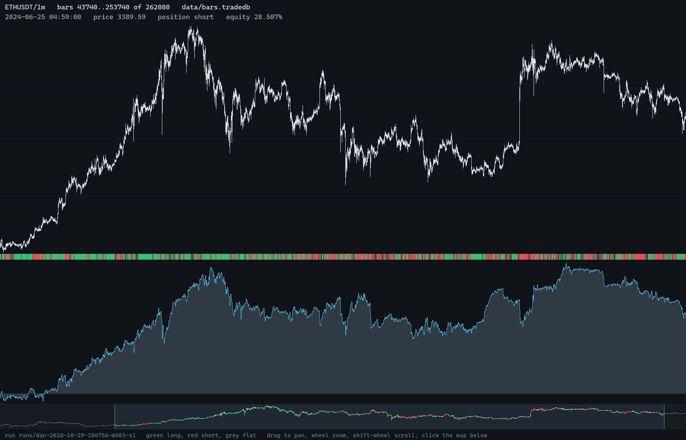

# trade-rl

An offline research bench for trading on price action using reinforcement
learning. After each bar closes, an agent picks short, flat or long;
walk-forward experiments then score it, after costs, against baselines and
controls. `trl` is the command line, and `trade-rl` shows bars, positions and
equity.



- **Data:** checksum-verified Binance archives or your own OHLC(V) CSVs,
  stored in [trade-db](https://github.com/ZacWalk/trade-db).
- **Agents:** two reinforcement learners, a Q-table and a double DQN, plus
  constant, random, crossover and breakout agents for comparison.
- **Honest scoring:** a cost curve, five baselines, shuffled and rotated
  controls, and results by calendar period.
- **Reproducible:** `trl verify` re-runs any experiment and requires
  byte-identical results, on Windows, Linux or macOS.

## Quick start

With Rust 1.88 or newer, and [trade-db](https://github.com/ZacWalk/trade-db)
cloned beside this repository:

```sh
cargo install --path crates/trl-cli && cargo install --path crates/trl-app
trl download --symbol ETHUSDT --kind klines --source 1m --from 2024-01-01 --to 2024-06-30
trl bars --in data/klines/ETHUSDT/1m
trl walk --agent dqn                      # writes runs/<id>
trade-rl --run runs/<id>
```

No network? `trl synth` stores a synthetic series to try everything on.

The [guide](docs/guide.md) covers every command, data format, agent and the
viewer; the [design](docs/design.md) explains how it all works.

## Development

```sh
cargo fmt --all --check
cargo clippy --workspace --all-targets -- -D warnings
cargo test --workspace
```

## License

MIT. See [LICENSE](LICENSE).
